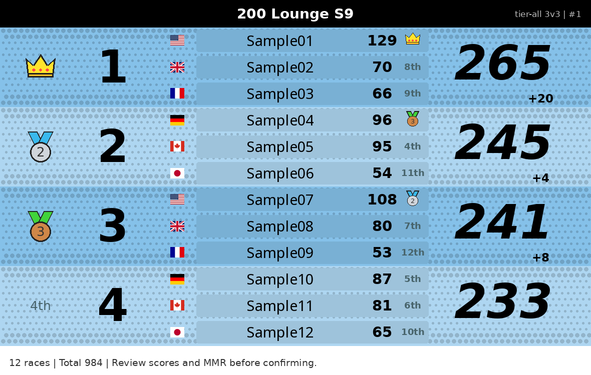
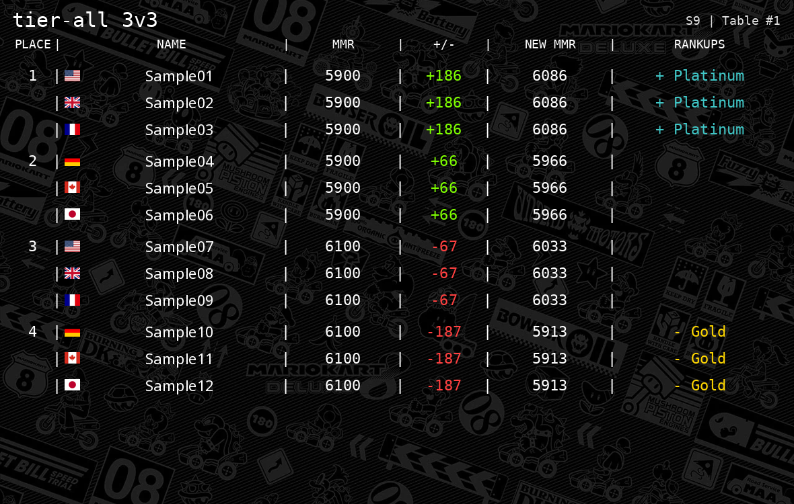

# Country flags and the legacy MMR card

Review branch: `codex/flags-mmr-card-review`. Website companion branch:
`PuffRepo/200-lounge.com:codex/s9-country-flags-review`.
Neither branch is the configured Railway deployment branch. Do not change the
production database, re-import the registry, or replace the SQLite volume.

## What changed

- Table previews and committed publications resolve country codes by stable
  Discord ID, including when a player has renamed since submitting a table.
- Only an explicit, valid ISO 3166-1 alpha-2 `country_code` is accepted.
  A single unambiguous country preserved in imported registration records is
  used automatically. Conflicting, missing or invalid records remain blank.
- Staff can record a verified country with `/set_country member:@Player code:JP
  reason:Verified MKC profile <profile URL>`. Use `code:-` to clear an incorrect
  country. Reporter permission alone cannot change countries. Updates and
  their previous values, actor and source/reason are durably audited in SQLite.
- The public S9 feed exports only `country_code`; source JSON, country audit
  reasons and actors remain private. Existing country-less feeds remain valid.
- Both local table cards use bundled PNG flags; the Lorenzi request includes
  `[JP]` when a country is known. No country image download is needed locally.
- The second card restores the legacy text-table presentation: pipe separators,
  `RANKUPS`, signed rank changes, blank unchanged ranks, green/red deltas and
  the original background. It keeps S9 ranks and V2 placement/accounting rules.
  No confirmation instructions are printed on the final MMR card.

The original bot queried MKCentral during verification. Imported MKC links were
marked unresolved; this patch does not guess a profile from a name or treat a
legacy MKC user ID as a current registry profile ID. It does not automatically
populate every missing country. Staff should use the verified profile as the
source for `/set_country`; bulk restoration requires a reviewed ID-to-country
export first. No production credentials or old database import are needed.

Country changes affect new previews and newly rendered cards. Already-posted
images are not edited or resent. Published-table retries still skip completed
parts and never reapply MMR. A country change during an open rating preview
invalidates its digest, requiring a fresh preview before confirmation.

## Local visual review

These are synthetic local fixtures, never production matches or Discord posts.




The local score card is the network-failure/international-name fallback;
Lorenzi remains the preferred renderer for safe ASCII names.

## Validation

Python 3.13, requirements-v2-backups.txt. Run:

```text
python scripts/run_solo_tests.py
python -m unittest discover -s tests -p test_production_backups.py -v
```

Tests cover country validation, conflicting imports, explicit clear/override,
read-only older databases, country audit privacy, stable IDs after renames,
flags on both cards, Lorenzi syntax, signed rank changes, staff access, and
publication retry deduplication. The existing accounting suite remains enabled.

## Review and release

1. Review this branch and the website companion branch. Merge each into its
   intended release branch locally first; preserve unrelated working files.
2. Run the V2 and backup suites with Python 3.13; run the website tests, build,
   and standalone smoke test. Do not start a second bot.
3. A push to bot `v2-production-integration`, or website
   `codex/s9-website-review`, may immediately deploy. Push only when ready to
   release the reviewed changes. No Railway configuration change is needed.
4. Bot startup adds only country metadata/audit tables to the existing SQLite
   database. Keep the current volume, backup supervisor and start command.
   The optional public feed may take up to its 60-second cache interval to
   reflect a country change. Reload the website after that refresh.

Safe Discord acceptance after an approved release: staff records an actual
player's verified country and source. Check that player's public feed entry,
leaderboard flag and profile flag. A Reporter without staff permission should
be refused by `/set_country`. Inspect flags and MMR formatting on the next real
submitted table; do not fabricate or apply a production match for testing.
Use local synthetic previews for layout checks before that match occurs.
