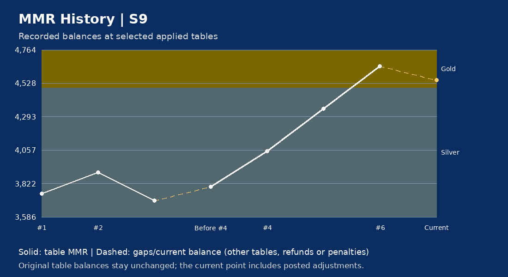

# Restore the S9 /stats graph

Review branch: `codex/stats-history-graph-review`, based on bot release 8bcc31c.
It does not include the separate manual bulk-country scripts or any automatic
country apply. No production data or deployment was changed for this patch.

/stats now embeds an attached PNG MMR graph, generated locally using the existing
Pillow dependency. Like the legacy graph, it has a dark blue background, MMR
axes and rank-colored bands. It uses all ten approved S9 ranks and requires no
external chart service, Matplotlib dependency, shared output file or bot startup.

The graph follows the command's member/name, tier, format and last-N filters.
It sorts selected applied events by immutable application sequence and plots
recorded before/after balances. It never sums filtered deltas to invent a new
rating history. Placement begins at its assigned rating, without a fictitious
zero-MMR point. Reversed tables are already excluded by the statistics snapshot.

Solid segments represent table changes. Dashed segments identify gaps between
selected table balances and the separately labeled current MMR point. Those
gaps can include unselected tables, refunds or penalties. A reduced loss retains
its original table-after balance; its refund appears in subsequent recorded
balances/current MMR. Refunds are not counted twice or retroactively backdated.
A player without matching table history receives the existing text summary
without an empty graph attachment.

Partner score average and average score in the embed also floor to two decimals,
matching the website change. Other statistics retain their existing formatting.

Synthetic local preview only, never a production match or Discord post:



Validation (Python 3.13 and requirements-v2-backups.txt):

```text
python scripts/run_solo_tests.py
python -m unittest discover -s tests -p test_production_backups.py
```

Regression coverage includes actual Pycord command attachments without login,
empty filters, filtered-history gaps, placement, refunds followed by later tables,
current adjustments, dense/flat/high-value charts and floor-format boundaries.
The existing correction, accounting, role synchronization and backup tests remain
in the release suite. No migrations, role updates or rating writes are introduced.

After an approved release, use /stats on an actual player with applied S9 tables,
then try a tier/format filter or last:10. Check the embed image and current point.
Use a registered player with no matching tables to check the text-only response.
Do not fabricate a production table for testing. A push to
v2-production-integration may auto-deploy; this review branch has not been pushed
to that deployment branch.
